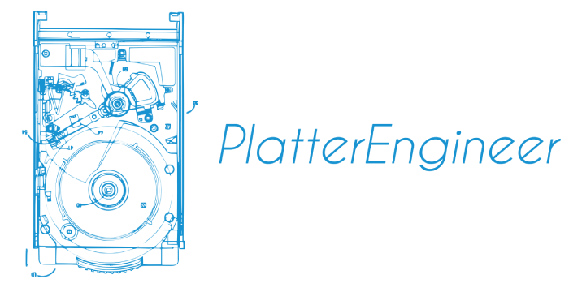

  

    <i>Platter Engineer is an arch linux based live image with a GUI optimized for rescuing, managing, partitioning and testing of disks.</i>

    <i>Built weekly, based on the latest technologies.</i>

    
    
    

